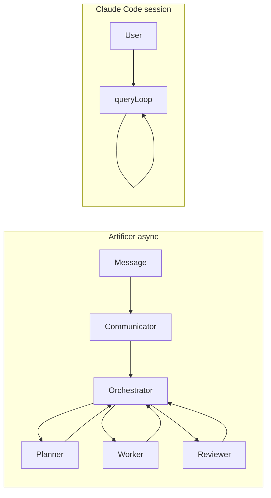
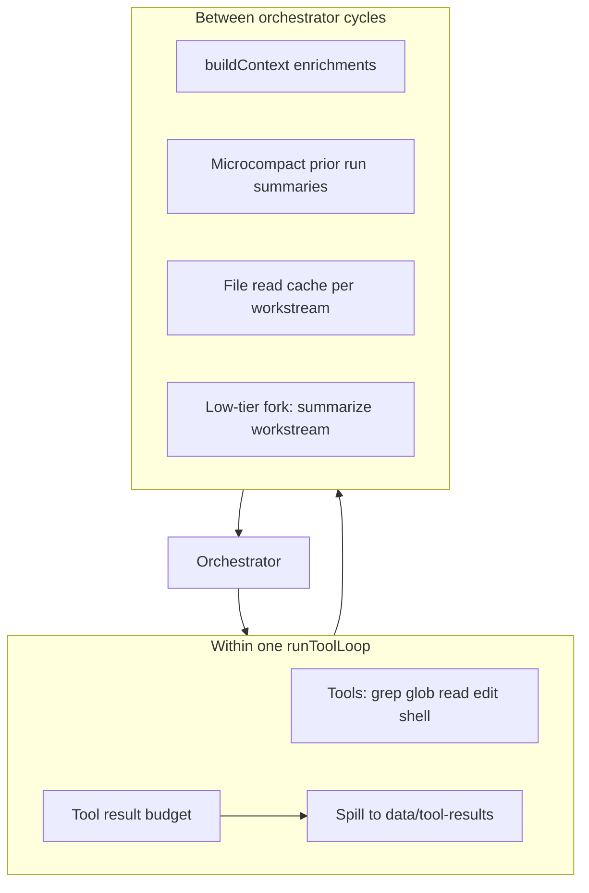

# Runtime Context Borrowing (Claude Code) — Design

**Date:** 2026-06-01
**Status:** Approved
**Component:** `packages/runtime`, `packages/runtime/bench` (validation), optional later `apps/runtime-ui` (telemetry)

**Related specs:** [Agent Memory & Teaching](2026-05-29-agent-memory-teaching-design.md) (librarian, signpost, pull-only recall — already implemented).

**Benchmark harness:** [packages/runtime/bench/README.md](../../../packages/runtime/bench/README.md) — used to measure cost and resolve rate before/after each phase.

## Goal

Improve **cost, context size, and codebase exploration quality** for async,
workstream-based coding runs by borrowing proven patterns from Claude Code
(sibling repo `../claude-code`), **without** replacing Artificer's architecture.

We keep the **hierarchical role graph** (`communicator` → `orchestrator` →
`planner` / `worker` / `reviewer` / `librarian`) and the **async scheduler**
([`engine/engine.ts`](../../../packages/runtime/src/engine/engine.ts),
[`engine/scheduler.ts`](../../../packages/runtime/src/engine/scheduler.ts)).
We add portable **context economics** and **tooling density** inside and between
calls — not a monolithic `query()` REPL loop.

## Non-negotiables (what we keep)

| Keep | Rationale |
|------|-----------|
| Multi-call role model ([`engine/roles.ts`](../../../packages/runtime/src/engine/roles.ts)) | Plan / implement / review separation reduces drift |
| `afterRun` orchestrator coalescing ([`engine/engine.ts`](../../../packages/runtime/src/engine/engine.ts)) | Async fan-in without N orchestrator storms |
| Convergence guards ([`engine/convergence.ts`](../../../packages/runtime/src/engine/convergence.ts)) | Anti-thrash on rejected reviews and unproductive runs |
| Tiered models + presets ([`engine/models.ts`](../../../packages/runtime/src/engine/models.ts), [`engine/presets.ts`](../../../packages/runtime/src/engine/presets.ts)) | Primary cost lever vs Claude Code's single-session routing |
| File-backed persistence ([`storage/layout.ts`](../../../packages/runtime/src/storage/layout.ts)) | Bench reproducibility and runtime-ui observability |
| Post-edit diagnostics ([`diagnostics/`](../../../packages/runtime/src/diagnostics/), [`tools/diagnose.ts`](../../../packages/runtime/src/tools/diagnose.ts)) | Right-sized feedback loop vs full LSP |

## Background — Artificer today

- **Inbound flow:** `POST /messages` → communicator run → optional workstream →
  orchestrator spawns planner / worker / reviewer children on the scheduler.
- **Call shape:** each run is one `runToolLoop`
  ([`llm/loop.ts`](../../../packages/runtime/src/llm/loop.ts)): `generateText`
  with tools until final text or `maxIterations`. Context is a **single user
  message** assembled in [`engine/call.ts`](../../../packages/runtime/src/engine/call.ts)
  (`buildContext`: task, workstream goal/summary, recent completed tasks, `git
  status --short`, memory signpost).
- **Tool surface:** [`tools/registry.ts`](../../../packages/runtime/src/tools/registry.ts)
  — planner, worker, and reviewer have `read_file`, `list_files`, `edit_file`,
  `run_shell`, git tools, and artifacts; **no dedicated `grep` or `glob`** (roles
  may mention grep in prompts but cannot call it except via shell).
- **Output handling:** shell, git, and fetch utilities **truncate** in-process;
  there is no disk offload of large tool results and no compaction across runs in
  a workstream.
- **Cache metrics:** [`llm/loop.ts`](../../../packages/runtime/src/llm/loop.ts)
  and [`engine/cost.ts`](../../../packages/runtime/src/engine/cost.ts) record
  `cacheReadInputTokens` / `cacheCreationInputTokens`, but each new run starts a
  fresh message list — no deliberate **stable prompt prefix** across calls in one
  workstream.
- **Memory:** pull-only recall via `query_memories` plus signpost (see related
  memory spec); librarian runs async on medium tier.

## Reference — Claude Code investigation

Source: leaked npm sourcemap tree at `../claude-code` (single Bun/TS app under
`src/`). Paths below are relative to that repo.

### Portable patterns (borrow)

| Area | Key files | What to borrow |
|------|-----------|----------------|
| Turn machine | `src/query.ts` | Compaction → API → tools loop ordering (adapt to **between-call**, not one transcript) |
| Tool results | `src/utils/toolResultStorage.ts` | Char budgets, spill large output to disk, preview + path in model context |
| Microcompact | `src/services/compact/microCompact.ts` | Clear old tool **content**, keep message structure (`[Old tool result content cleared]`) |
| Full compact | `src/services/compact/autoCompact.ts` | LLM summarization at context limit (Phase B+ fork only if needed) |
| Tools | `src/Tool.ts`, `src/services/tools/toolExecution.ts` | Validate → policy/hooks → execute → format result |
| Search | `src/tools/GrepTool/`, `src/tools/GlobTool/` | First-class ripgrep; discourage raw `grep` in bash |
| File cache | `src/utils/fileStateCache.ts` | LRU of reads + mtime; partial-view tracking |
| Cache forks | `src/utils/forkedAgent.ts` | Side jobs with identical system/tools/message prefix for prompt cache hits |
| Deferred tools | `src/utils/toolSearch.ts` | Tool schemas discovered on demand when MCP bloats context (Phase C) |
| Bash policy | `src/tools/BashTool/`, `src/utils/permissions/bashPermissions.ts` | Classify read vs write; deny without UI in batch mode |

### Session-specific (do not port)

| Area | Why skip for Artificer |
|------|------------------------|
| Ink REPL (`src/screens/REPL.tsx`, components) | We are HTTP + async workstreams, not terminal chat |
| Interactive permissions (`src/hooks/useCanUseTool.tsx`) | Replace with config/policy engine |
| Bridge / swarm / teleport (`src/bridge/`, `src/utils/swarm/`) | Multi-session realtime coordination |
| KAIROS / cron / push assistant | Always-on product surface |
| Streaming tool UI (`StreamingToolExecutor` + JSX renderers) | Optional later; not required for batch |
| Full LSP (`src/services/lsp/`) | Keep post-edit diagnostics only |

### Architecture comparison

**Caption:** Borrow **mechanisms** (search, result storage, microcompact, policy)
into **within-call** and **between-call** layers. Do **not** replace the role graph
with `query()`.

## Design principles

1. **Between-call economics** — Most context work happens when building the next
   role's prompt (`buildContext`) and when persisting run tool invocations, not by
   growing one global transcript.
2. **Within-call budgets** — Cap and spill tool output during `runToolLoop` so a
   single worker run cannot blow the context window on one bash log.
3. **Policy over prompts** — Shell and path rules enforced in code + env (bench
   mode), not permission dialogs.
4. **Bench-measurable** — Each phase ships with acceptance criteria on
   [mini-suite](../../../packages/runtime/bench/tasks/mini-suite.json) via
   [bench/README](../../../packages/runtime/bench/README.md) (median input tokens,
   tool-step count, resolve rate, USD per instance).
5. **Minimal dependencies** — Prefer `rg` on `PATH` and Node builtins; no MCP in
   Phases A–B.

## Target architecture

### Integration hooks (existing code)

| Hook | Use |
|------|-----|
| Run `toolInvocations` on `RunRecord` | Source for microcompact summaries; spill metadata |
| `buildContext` in [`call.ts`](../../../packages/runtime/src/engine/call.ts) | Inject file-cache hints, compacted prior-run digest, attachments |
| [`Layout`](../../../packages/runtime/src/storage/layout.ts) | New `toolResultsDir(runId)`, `workstreamFileCache(workstreamId)` |
| `Engine.emit` / SSE | Optional `tool_result_spilled` for UI and bench |
| Orchestrator `invoke_call` | Phase B: spawn low-tier summarizer after worker completes |

## Phased roadmap

### Phase A — Cost and exploration (highest ROI)

**Dependencies:** none (baseline). **Rollback:** feature flags per item (env).

#### A1. Grep + Glob tools

| | |
|--|--|
| **Problem** | Workers/planners explore via `read_file` + `run_shell grep`, which is slow, expensive, and noisy in context. |
| **CC reference** | `src/tools/GrepTool/`, `src/tools/GlobTool/` — dedicated ripgrep; prompts forbid bash `grep`. |
| **Approach** | New `src/tools/search.ts`: `grep` (pattern, path, glob, head_limit) and `glob` (pattern, cwd) scoped to **workspace** with path traversal guard (same as [`files.ts`](../../../packages/runtime/src/tools/files.ts)). Invoke `rg` subprocess; require `rg` on `PATH` (document in bench README). |
| **Roles** | `planner`, `worker`, `reviewer` (see Open questions for reviewer). Optional read-only `grep` for `orchestrator`. |
| **Config** | `RUNTIME_REQUIRE_RG=true` (default true in bench). |
| **Acceptance** | Mini-suite: fewer `read_file`/`run_shell` steps; similar or better resolve rate. |

#### A2. Tool result budget + spill

| | |
|--|--|
| **Problem** | Large shell/test output fills the tool loop context; truncation loses recoverability. |
| **CC reference** | `src/utils/toolResultStorage.ts` — per-tool threshold, aggregate per-message cap, persist to `tool-results/`. |
| **Approach** | New `src/storage/tool-results.ts`. On tool return in [`llm/loop.ts`](../../../packages/runtime/src/llm/loop.ts) (or shared wrapper): if output exceeds `RUNTIME_TOOL_RESULT_MAX_CHARS`, write full body to `ARTIFICER_DATA_DIR/tool-results/<runId>/<n>.txt`, return preview + absolute path. Spill dir is **never** under workspace (security). Add `read_tool_result` tool OR document that paths under data dir are readable only via that tool (see Open questions). |
| **Roles** | All roles that use `run_shell`, `grep`, `read_file` (large reads). |
| **Config** | `RUNTIME_TOOL_RESULT_MAX_CHARS` (default e.g. 12_000), `RUNTIME_TOOL_RESULT_MAX_PER_RUN_CHARS` (aggregate cap). |
| **Acceptance** | Synthetic run with huge shell output: model sees short preview; full file on disk; run completes without context overflow. |

#### A3. Microcompact between calls

| | |
|--|--|
| **Problem** | Prior runs' tool outputs are re-injected only via `recentWorkSummary` (task result clips); no systematic clearing of bulky history. |
| **CC reference** | `src/services/compact/microCompact.ts` — `COMPACTABLE_TOOLS`, cleared placeholder message. |
| **Approach** | New `src/engine/context-compact.ts`. When `buildContext` runs for workstream W, load last K completed runs' tool invocations; for compactable tools (`read_file`, `run_shell`, `grep`, `glob`, `fetch_url`), replace stored **output** in the digest with `[Old tool result content cleared]` while keeping tool name, args, and timestamp. Persisted run files on disk stay intact; only the **prompt digest** is compacted. Gated by `RUNTIME_MICROCOMPACT_ENABLED`. |
| **Dependencies** | A2 recommended first (spill paths referenced in digest as paths, not bodies). |
| **Acceptance** | Long workstream: Nth worker call prompt size grows sublinearly in total historical tool output. |

#### A4. Workstream file cache

| | |
|--|--|
| **Problem** | Each new call re-reads the same files; no cross-call memory of what was already seen. |
| **CC reference** | `src/utils/fileStateCache.ts` |
| **Approach** | New `src/engine/file-cache.ts` + `workstreams/<id>/file-cache.json`. On successful `read_file`, record `{ path, mtime, lineRange?, snippet }`. LRU capped by `RUNTIME_FILE_CACHE_MAX_ENTRIES`. Inject into `buildContext` for `WORK_ROLES` (planner, worker, reviewer): one block listing recently read paths — no full content. |
| **Acceptance** | Second worker call on same file includes cache hint; model can skip redundant full read when appropriate. |

**Phase A — planned file touch**

| Action | Path |
|--------|------|
| Create | `src/tools/search.ts` |
| Create | `src/storage/tool-results.ts` |
| Create | `src/engine/context-compact.ts` |
| Create | `src/engine/file-cache.ts` |
| Modify | `src/tools/registry.ts`, `src/engine/roles.ts`, `src/engine/call.ts`, `src/storage/layout.ts`, `src/config.ts`, `src/llm/loop.ts`, `.env.example` |

**Phase A bench acceptance:** Compare `bench-budget` preset on mini-suite before/after; target lower median `inputTokens` and/or fewer exploration tool steps at **similar** resolve rate ([`bench/results/report.md`](../../../packages/runtime/bench/results/report.md)).

**Phase A risks:** `rg` missing in CI/Docker images; grep path guard bugs (workspace escape). Mitigation: clear startup check and unit tests on path guard.

---

### Phase B — Cheap side intelligence

**Dependencies:** Phase A (stable tool surface + spill paths). **Rollback:** env flags.

#### B1. Cache-stable fork calls (workstream summarization)

| | |
|--|--|
| **Problem** | Workstream `summary` updates are implicit or thin; orchestrator context lacks a cheap, fresh narrative of progress. |
| **CC reference** | `src/utils/forkedAgent.ts` — `CacheSafeParams` (system, tools, message prefix must match parent for Anthropic prompt cache). |
| **Approach** | New `src/engine/fork.ts`. After worker or planner completes, orchestrator may `invoke_call` a **low-tier** one-shot role (e.g. reuse `reviewer` read-only tools or dedicated `summarizer` prompt) with: frozen system prompt hash per workstream, same tool JSON ordering, prefix = last orchestrator context + compacted run digest. Output: `update_status` / store patch to `workstream.summary`. Complements [memory spec](2026-05-29-agent-memory-teaching-design.md) — does **not** auto-inject memory content. |
| **Config** | `RUNTIME_WORKSTREAM_SUMMARY_FORK=1`, max output tokens low (e.g. 1024). |
| **Acceptance** | Cache read tokens on fork call ≥ threshold vs cold call (logged); summary quality manually spot-checked. |

#### B2. Shell policy layer

| | |
|--|--|
| **Problem** | `run_shell` is unconstrained except timeout and output cap — risky in bench and costly when destructive. |
| **CC reference** | Bash classifier + permission modes (non-interactive path only). |
| **Approach** | New `src/tools/shell-policy.ts`. Classify command string: `read`, `search`, `test`, `write`, `network`, `unknown`. Modes: `permissive` (default dev), `bench` (deny write/network), `strict` (read/search/test only). Denial returns tool error string (model can adapt). |
| **Config** | `RUNTIME_SHELL_POLICY=permissive|bench|strict`; bench driver sets `bench`. |
| **Acceptance** | Bench mode blocks `rm -rf` / `curl`; allows `pytest`, `git diff`, `rg`. |

#### B3. Prompt cache telemetry

| | |
|--|--|
| **Problem** | Cache misses are invisible; hard to tune presets. |
| **CC reference** | `src/services/api/promptCacheBreakDetection.ts` |
| **Approach** | New `src/engine/cache-telemetry.ts`. Per run: hash(system + tool names + model id); log `cacheRead`/`cacheCreation` delta; optional warning when read tokens drop vs prior run same role. Expose in run record JSON and bench `attempts.json`. |
| **Acceptance** | Bench report includes cache hit rate column per instance. |

**Phase B — planned file touch:** `src/engine/fork.ts`, `src/tools/shell-policy.ts`, `src/engine/cache-telemetry.ts`, `src/tools/shell.ts`, `src/tools/orchestrator-tool.ts` (when to trigger summary fork).

**Phase B risks:** Fork summarizer hallucinates progress — mitigate with read-only tools + git status in fork prompt. Cache key drift if tool list changes mid-workstream — freeze tool list per workstream id.

---

### Phase C — Optional depth

**Dependencies:** Phase A stable; B1/B3 optional. Implement only when a concrete need appears.

| Item | Summary |
|------|---------|
| **C1. Deferred tool registry** | If MCP or large tool sets land: ToolSearch-style `discover_tools` so initial prompt stays small (`../claude-code/src/utils/toolSearch.ts`). |
| **C2. Background shell + poll** | Long tests: spawn detached process, `task_output` poll tool — fits async polling better than blocking `run_shell` (`LocalShellTask` pattern in CC). |
| **C3. Hooks** | User-defined shell on `tool_complete` / `workstream_done` for CI/bench (subset of `../claude-code/src/utils/hooks.ts`). |
| **C4. Declarative agent overrides** | Optional `.artificer/agents/*.md` (tools + tier) for bench presets without replacing code roles in `roles.ts`. |

---

## Per-phase decisions (recommended defaults)

| Decision | Phase | Default |
|----------|-------|---------|
| Ripgrep binary | A1 | Require `rg` on `PATH`; fail tool with install hint |
| Spill storage location | A2 | Under `ARTIFICER_DATA_DIR/tool-results/` only |
| Read spilled output | A2 | Dedicated `read_tool_result` tool (preferred over `read_file` on data dir) |
| Compactable tools | A3 | `read_file`, `run_shell`, `grep`, `glob`, `fetch_url` |
| File cache scope | A4 | Per-workstream, not per-run |
| Summary fork trigger | B1 | After worker `done` with file changes, or every N worker runs |
| Shell policy in bench | B2 | `RUNTIME_SHELL_POLICY=bench` set by bench driver |
| Phase B order | B | Shell policy (B2) before summary fork (B1) if only one sprint — see Open questions |

## Role and tool matrix (after Phase A)

| Role | grep / glob | spill-aware tools | file cache hint | notes |
|------|-------------|-------------------|-----------------|-------|
| communicator | — | — | — | unchanged |
| orchestrator | optional grep | read/list | — | status checks only |
| planner | yes | yes | yes | prompt: prefer grep over shell grep |
| worker | yes | yes | yes | prompt: forbid bash grep/rg |
| reviewer | yes | read/shell/git + spill | yes | grep/glob for verification; writes via shell policy in bench |
| librarian | — | fetch | — | unchanged |

## Config and observability

New environment variables (defaults set during implementation):

| Variable | Purpose |
|----------|---------|
| `RUNTIME_TOOL_RESULT_MAX_CHARS` | Per-invocation spill threshold |
| `RUNTIME_TOOL_RESULT_MAX_PER_RUN_CHARS` | Aggregate cap per run |
| `RUNTIME_MICROCOMPACT_ENABLED` | Between-call digest compaction |
| `RUNTIME_FILE_CACHE_MAX_ENTRIES` | LRU size for workstream file cache |
| `RUNTIME_SHELL_POLICY` | `permissive` \| `bench` \| `strict` |
| `RUNTIME_WORKSTREAM_SUMMARY_FORK` | Enable B1 fork summarizer |
| `RUNTIME_REQUIRE_RG` | Fail fast if ripgrep missing |

**SSE:** optional event `tool_result_spilled` `{ runId, tool, path, previewChars }` via
[`context.ts`](../../../packages/runtime/src/context.ts).

**Bench:** document new env vars in
[`packages/runtime/bench/README.md`](../../../packages/runtime/bench/README.md);
compare `attempts.json` metrics pre/post phase.

## Error handling

- **`rg` missing:** `grep`/`glob` return clear error; bench README lists install.
- **Spill write failure:** fall back to hard truncate + note in output; log warning.
- **File cache stale mtime:** treat as miss; re-read allowed.
- **Shell policy deny:** tool error string (not run failure); model may retry with allowed command.
- **Microcompact with no prior runs:** no-op; context unchanged.
- **Fork summarizer failure:** orchestrator continues; summary field unchanged; log run `failed`.

## Testing

- **Unit:** path guard on grep; spill/truncate thresholds; microcompact digest transform;
  file-cache LRU; shell classifier cases; cache telemetry hash stability.
- **Integration:** one workstream with oversized `run_shell` → spill file exists → next
  `buildContext` uses compacted digest.
- **Bench:** A/B `bench-budget` on mini-suite per phase; record median input tokens, USD,
  resolve rate, steps-to-patch in PR description.

## Out of scope

- Merging roles into a single Claude Code-style `query()` loop.
- Ink REPL, interactive permission UI, bridge/swarm, KAIROS/cron.
- Full LSP integration (keep diagnostics-on-edit).
- MCP / ToolSearch (Phase C only, if ever).
- Semantic memory embeddings ([memory spec](2026-05-29-agent-memory-teaching-design.md)).
- Real-time token streaming to runtime-ui.
- Vendoring Claude Code source into this repo.

## Resolved decisions (2026-06-01)

1. **Reviewer gets `grep` / `glob`** — faster verification; destructive shell blocked in `bench` policy (Phase B).
2. **`read_tool_result` tool** — dedicated tool for spilled output under `ARTIFICER_DATA_DIR`; `read_file` stays workspace-only.
3. **Phase B order:** shell policy (B2) before workstream summary fork (B1).

---

## Implementation follow-up

Task-level plan: [Runtime Context Borrowing implementation plan](../plans/2026-06-01-runtime-claude-code-borrowing.md). Phase A ships as the first implementation PR; Phase B follows after bench baseline.
