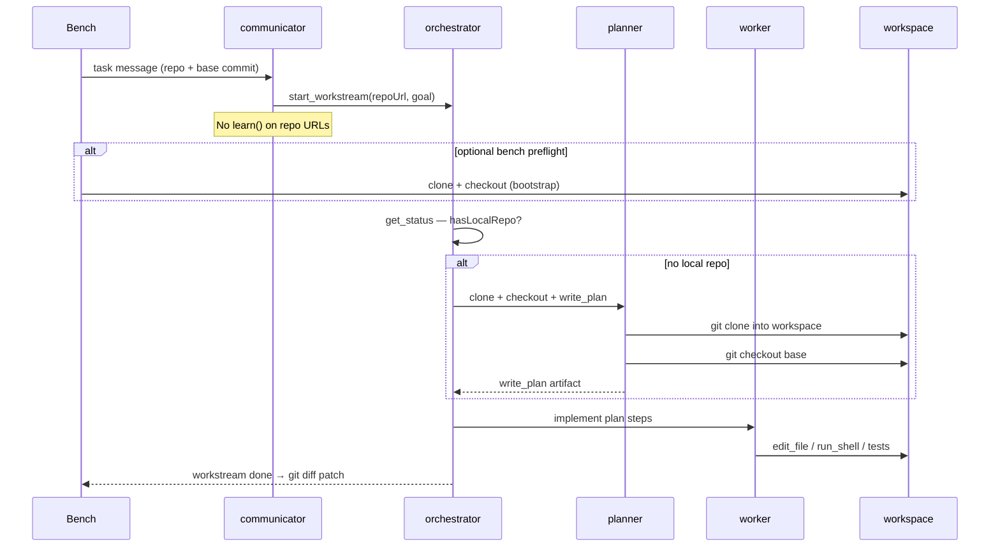

# Runtime Repo Orchestration — Design

**Date:** 2026-06-02  
**Status:** Draft (for review)  
**Component:** `packages/runtime`, `packages/runtime/bench`  
**Related:** [Context Borrowing design](2026-06-01-runtime-claude-code-borrowing-design.md), [Agent Memory & Teaching](2026-05-29-agent-memory-teaching-design.md)

## Goal

Make Artificer reliably **set up and edit GitHub repositories** in bench and production async runs. Today, repo-fixing tasks often stall before any patch is produced — not because models cannot code, but because orchestration sends work down the wrong path (librarian web fetch, out-of-workspace clones, missing setup gates).

Success means a bench run on `true-myth-iterable-collection-combinators` reaches **local repo + non-zero patch** within the first few minutes, comparable to successful DeepSWE Harbor runs.

## Problem statement

### Observed failures (Artificer bench)

| Run | Preset | Duration | Patch | Outcome | Root symptom |
|-----|--------|----------|-------|---------|--------------|
| go-economy | DeepSWE TS mini | 20m | 0B | timeout | 3 workstreams; 16× librarian `fetch_url`; never cloned |
| go-quality | DeepSWE TS mini | 16m | 0B | blocked | 11× librarian; planner cloned to `/tmp`; 3× planner without `write_plan` |
| quality-first | DeepSWE TS mini | 20m | 634KB | timeout | **Worked** — planner cloned to `repo/` in workspace ~1m |

Failed runs share a pattern:

1. **Communicator fires `learn`** on repo URLs / source references in the task message → spawns librarian backlog.
2. **Librarian uses `fetch_url`** on GitHub instead of cloning — no files in workspace.
3. **Orchestrator waits or loops** in `planning` while librarians run; `invoke_call` does not reliably produce a cloning planner.
4. **Planner clones outside workspace** (`/tmp/true-myth-repo`) when it finally runs — patch extraction finds `no git repository found in workspace`.
5. **Convergence guard blocks** after 3 planner runs without `write_plan` (`MAX_UNPRODUCTIVE_WORK_RUNS`).

### What “success” looks like elsewhere (DeepSWE Harbor)

Reference trajectories for the **same task** ([kimi-k2.6](https://d3ujjcmjq6o8v6.cloudfront.net/trial-artifacts/true-myth-iterable-collection-combinators__TBGQukY/agent/trajectory.json), [gpt-5.5](https://d3ujjcmjq6o8v6.cloudfront.net/trial-artifacts/true-myth-iterable-collection-co__CbCbTqk/agent/trajectory.json)):

| Property | Harbor / mini-swe-agent | Artificer (failed) | Artificer (quality-first, partial success) |
|----------|-------------------------|--------------------|---------------------------------------------|
| Agent shape | Single loop, one role, bash-only | 6 roles, async scheduler | Same |
| Repo at start | **Pre-checked-out** at `.` (`.git` present) | Empty workspace | Empty until planner clones |
| First action | `find .` / `ls -la` on local tree | `learn` → `fetch_url` | `start_workstream` → planner `git clone repo` |
| Clone step | **None** (env provides repo) | Missing or wrong path | `git clone … repo` in workspace |
| Investigation | `cat`/`sed`/`grep` on `./src/*` | HTTP fetch of raw GitHub | `run_shell` on cloned repo |
| Edit surface | bash (`sed`, `python3`, `cat <<EOF`) | `edit_file` (never reached) | `edit_file` on `repo/src/*` |
| Termination | `echo COMPLETE_TASK_AND_SUBMIT_FINAL_OUTPUT` | timeout / blocked | timeout (patch extracted) |
| Steps / cost (gpt-5.5 ref) | 28 steps, ~$1.91 total | 18–27 LLM calls, $0.11–0.35 (no patch) | 16 calls, $1.00, 634KB patch |

**Key insight:** Harbor never asks the model to clone. The task prompt assumes the repo is already on disk. Artificer’s bench message explicitly requires clone + checkout, but the **role graph does not enforce that setup gate** — and weak models treat repo URLs as “material to learn” instead of “workspace to create.”

## Design principles

1. **Setup before strategy** — No planner/reviewer/worker investigation until a git repo exists in the workstream workspace (or bootstrap preflight completed).
2. **Local files beat URLs** — Repo source code is read via `read_file` / `grep` / `run_shell` on a clone, never via librarian `fetch_url` for implementation work.
3. **One workstream per bench task** — Communicator must not fan out parallel workstreams for a single SWE task.
4. **Workspace is the patch surface** — All clones and edits must stay under `{dataDir}/workspace/{workstreamId}/` so `extract-patch.ts` can grade.
5. **Preserve role separation** — Fix orchestration and gates; do not collapse to a single-agent loop (that’s a separate experiment).
6. **Measure setup, not just resolve rate** — Bench metrics must expose clone latency, `learn` misuse, and out-of-workspace commands before we tune model presets.

## Architecture (target state)



### Workstream lifecycle additions

Extend workstream state (in summary or explicit fields) with **setup status**:

| Flag | Meaning |
|------|---------|
| `repoUrl` | Set at `start_workstream` (parsed from bench or communicator) |
| `baseCommit` | Optional; set from structured bench intake |
| `localRepoReady` | Derived: `findGitRepo(workspaceDir)` succeeded |
| `planReady` | Plan artifact exists |

Orchestrator prompt + optional code gate: **if `repoUrl` and not `localRepoReady`, next call must be planner with clone instructions — never librarian, never memory-only investigation.**

## Phase A — Prompt & intake guardrails (high impact, low risk)

### A1. Communicator: repo tasks are work, not teaching

**File:** `packages/runtime/src/engine/roles.ts` (`COMMUNICATOR`)

Add explicit rules:

- When the message asks to fix/implement/clone a repository: call **`start_workstream` once**, pass **`repoUrl`** when present, then **`reply`** and stop.
- **Do not call `learn`** on GitHub URLs, file paths, or source references embedded in a coding task.
- **Do not call `add_memory`** for source code during task intake.
- **Do not spawn multiple workstreams** for one bench/SWE message unless the user explicitly requested parallel unrelated tasks.

**File:** `packages/runtime/src/tools/communication.ts`

- Extend `start_workstream` handler docstring to say repo tasks must pass `repoUrl`.

### A2. Structured bench intake

**File:** `packages/runtime/bench/src/run-instance.ts` (`buildTaskMessage`)

Add a machine-readable header the communicator can copy into `start_workstream`:

```
--- WORKSTREAM ---
repoUrl: https://github.com/true-myth/true-myth.git
baseCommit: d8fbebc75de4991a32354518beff1abf628d0b07
title: true-myth iterable collection combinators
---
```

**Optional stronger path:** bench API to create workstream directly (skip communicator for eval runs). Defer unless A1 insufficient.

**File:** `packages/runtime/src/engine/call.ts` (`buildContext`)

When `ws.baseCommit` is set (new optional field on `Workstream`), include in planner/worker context:

```
Base commit (checkout exactly): {baseCommit}
Workspace: clone repo into this directory (`.` or `repo/`), not /tmp.
```

### A3. Planner: workspace clone contract

**File:** `packages/runtime/src/engine/roles.ts` (`PLANNER`)

Strengthen existing clone guidance:

- First actions for repo tasks: `git clone {repoUrl} repo` (or `.` if empty workspace), then `git checkout {baseCommit}`.
- **Never clone to `/tmp` or absolute paths outside the workspace.**
- Use `read_file` / `grep` after clone — do not `fetch_url`.
- Complete with **`write_plan`**; exploration-only runs are failures.

### A4. Orchestrator: setup gate

**File:** `packages/runtime/src/engine/roles.ts` (`ORCHESTRATOR`)

Add to process section (before “spawn planner for plan”):

```
0. Setup gate: if the workstream has a repoUrl and get_status / list_files shows
   no git repo in the workspace, spawn a planner whose ONLY job is:
   clone into workspace, checkout base commit, then write_plan.
   Do not spawn librarian. Do not rely on query_memories for source code.
   Do not mark planning complete until write_plan succeeds.
```

### A5. Librarian: scope restriction

**File:** `packages/runtime/src/engine/roles.ts` (`LIBRARIAN`)

Add:

- You are **not** for cloning repositories or reading implementation source during active coding workstreams.
- If task material is a GitHub repo URL for a fix/implement request, finish without fetching — that work belongs to planner/worker.

## Phase B — Structural enforcement

### B1. Shell policy: workspace-bound git clone

**File:** `packages/runtime/src/tools/shell-policy.ts` (from context-borrowing plan)

Reject or rewrite commands where `git clone` target resolves outside `workspaceDir`:

```typescript
// Pseudocode
if (gitCloneTargetIsOutsideWorkspace(command, workspaceDir)) {
  return block("Clone into workspace subdirectory, e.g. `git clone URL repo`");
}
```

Allow: `git clone URL .`, `git clone URL repo`, `cd repo && …` with workspace-relative `cwd`.

### B2. Communicator `learn` backpressure

**File:** `packages/runtime/src/tools/communication.ts` + `packages/runtime/src/engine/engine.ts`

When inbound message matches repo-task heuristics (`clone`, `github.com`, `base commit`, bench header):

- Refuse `learn` with tool error: *“Use start_workstream for repo tasks; learn is for reference material only.”*
- Or cap: max 0 librarian spawns from communicator when workstream started for same message.

Heuristic can live in a small `packages/runtime/src/engine/task-intent.ts` helper shared by communicator tool handlers and bench warnings.

### B3. Workstream fields

**Files:** `packages/runtime/src/storage/types.ts`, `store.ts`, `communication.ts`

```typescript
interface Workstream {
  // existing…
  repoUrl?: string;
  baseCommit?: string;  // new
}
```

Populate from `start_workstream` input and bench structured header parsing in communicator.

### B4. Orchestrator setup gate (code-level, optional hard gate)

**File:** `packages/runtime/src/engine/engine.ts` or `orchestrator-tool.ts`

Before accepting `invoke_call` for `reviewer` or `worker`:

- If workstream has `repoUrl` and `findGitRepo(workspaceDir)` is undefined → return tool error directing orchestrator to spawn setup planner.

Soft gate (prompt-only) in Phase A; hard gate in Phase B if models still skip clone.

### B5. Convergence tuning for setup failures

**File:** `packages/runtime/src/engine/engine.ts` (`isUnproductiveWorkRun`)

Do **not** count planner runs as unproductive when `!localRepoReady` — instead re-spawn planner at higher complexity with explicit clone task, or block with `setup_incomplete` reason (distinct from model thrash).

## Phase C — Bench bootstrap (eval reliability)

### C1. Optional preflight clone

**File:** `packages/runtime/bench/src/run-instance.ts`

Env flag `BENCH_PREFLIGHT_CLONE=true` (or always-on for DeepSWE):

1. Create workstream workspace dir.
2. `git clone --depth 1 {repoUrl} {workspace}/repo`
3. `git checkout {baseCommit}`
4. Send shortened task message: “Repo is cloned at `repo/`. Implement …”

**Purpose:** Separates “can the model fix code?” from “can it clone?” — mirrors Harbor environment. Use for preset comparisons; keep full clone path for orchestration regression tests.

### C2. Bench observability

**File:** `packages/runtime/bench/src/run-instance.ts`, `attempts.json` schema

Record on each attempt:

| Field | Description |
|-------|-------------|
| `learnCallCount` | communicator `learn` invocations |
| `localRepoReady` | bool at timeout/end |
| `cloneLocation` | path if git repo found |
| `setupPhaseMs` | time until first `git clone` in workspace or preflight |
| `firstEditMs` | time until first `edit_file` / shell write |

**File:** `packages/runtime/bench/src/main.ts`

Warn at start if Go/Zen model mismatch (existing) **and** if communicator log shows `learn` before planner.

## Phase D — Validation matrix

### Setup pass criteria (first 5 minutes)

On `pnpm bench:deepswe:typescript:go-economy --limit 1`:

- [ ] ≤ 1 workstream started
- [ ] 0 communicator `learn` calls
- [ ] `git clone` into `{workspace}/{workstreamId}/**` before minute 3
- [ ] `write_plan` before minute 10
- [ ] `patchBytes > 0` at timeout (even if eval fails)

### Preset comparison (same task)

| Config | Expect |
|--------|--------|
| go-economy + Phase A | clone + patch |
| go-quality + Phase A | clone + patch, higher quality plan |
| go-economy + Phase C preflight | measures coding-only ceiling |
| quality-first (baseline) | maintain ≥634KB patch behavior |

### Regression guards

- Non-repo messages still use `learn` normally (memory teaching spec).
- Multi-workstream user requests still work when explicitly unrelated.

## Borrowings from successful DeepSWE trajectories

Patterns to adopt **without** abandoning Artificer roles:

| Harbor pattern | Artificer adaptation |
|----------------|---------------------|
| Repo already at `.` | Bench preflight clone **or** enforced planner clone into workspace |
| Step 1: `find .` / `ls -la` | Planner step 1 after clone: `list_files` + `grep` on local tree |
| Explicit workflow: analyze → edit → test → submit | Orchestrator enforces planner plan with test steps; worker runs `pnpm test` / vitest |
| Every turn includes bash | Worker/planner already have `run_shell`; ensure clone uses workspace cwd |
| Single-agent context growth | Keep microcompact + file cache (context borrowing plan) on planner/worker runs |
| `COMPLETE_TASK` terminal | Map workstream `done` + patch extraction (no literal echo needed) |

Patterns **not** to port:

- Single monolithic agent (loses review/plan separation)
- Unbounded bash without workspace policy
- Adding tests to repo in bench (DeepSWE agent added test files; our bench forbids modifying tests)

## File change summary

| Phase | Files |
|-------|-------|
| A | `engine/roles.ts`, `bench/src/run-instance.ts`, `engine/call.ts` |
| B | `tools/shell-policy.ts`, `tools/communication.ts`, `storage/types.ts`, `engine/engine.ts`, `engine/task-intent.ts` (new) |
| C | `bench/src/run-instance.ts`, `bench/src/types.ts`, `bench/README.md` |
| D | `bench/src/main.ts` (warnings), tests in `engine/*.test.ts`, `bench/` integration |

## Non-goals

- Replacing hierarchical roles with mini-swe-agent single loop
- Auto-resolving SWE-bench eval (Docker harness unchanged)
- Changing Go model presets (orthogonal once setup works)
- Teaching librarian to clone repos (wrong tool; keep librarian for durable memory)

## Open questions

1. **Bench bypass communicator?** Structured workstream creation would remove communicator variance from eval — worth A/B vs prompt-only fixes.
2. **Always-on preflight clone?** Simplest path to comparable Harbor metrics; hides clone orchestration bugs unless we run both modes.
3. **Minimum orchestrator tier for repo tasks?** Data suggests `deepseek-v4-flash` orchestrator mis-routes; may need `go-economy-plus` with medium orchestrator without full quality stack.

## References

- Failed logs: `bench/results/go-economy/deepswe-typescript-mini/`, `bench/results/go-quality/deepswe-typescript-mini/`
- Partial success: `bench/results/phase-a-validation/deepswe-typescript-quality-first.log`
- Successful Harbor trajectories: [kimi-k2.6 run](https://d3ujjcmjq6o8v6.cloudfront.net/trial-artifacts/true-myth-iterable-collection-combinators__TBGQukY/agent/trajectory.json), [gpt-5.5 run](https://d3ujjcmjq6o8v6.cloudfront.net/trial-artifacts/true-myth-iterable-collection-co__CbCbTqk/agent/trajectory.json)
- Artificer patch extraction: `packages/runtime/bench/src/extract-patch.ts`
- Convergence guard: `packages/runtime/src/engine/engine.ts` (`MAX_UNPRODUCTIVE_WORK_RUNS`)
