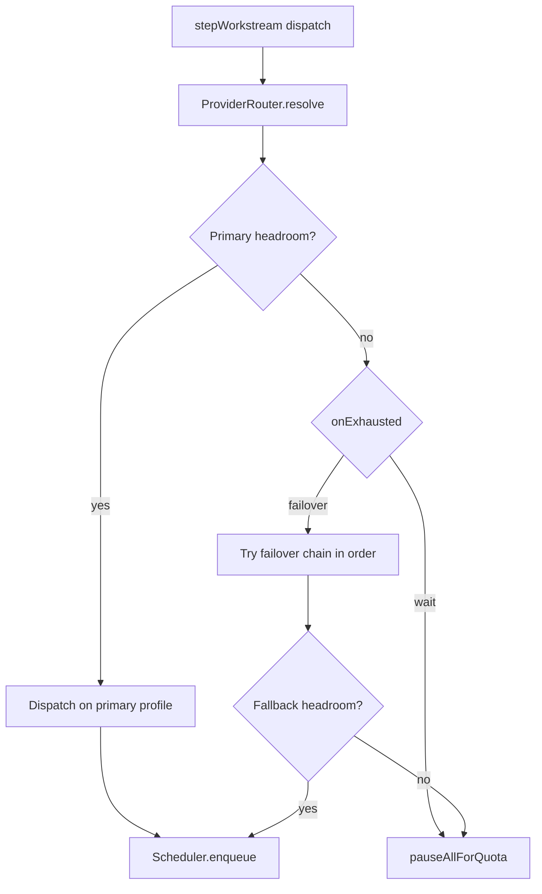

# Quota Tracking — Windowed Subscriptions and Metered Budgets

**Date:** 2026-06-28  
**Status:** Approved (implemented 2026-06-28; routes model + agent self-config 2026-06-28)  
**Component:** `packages/runtime`, `apps/runtime-ui`, `packages/cli`  
**Related:** [Cost Architecture](2026-06-02-runtime-orchestration-cost-architecture-design.md), [Cursor Agent Executor](2026-06-26-cursor-agent-executor-design.md)

## Summary

Add a **QuotaLedger** to the runtime Engine so artificer can track and enforce usage limits across **both** billing models:

1. **Windowed subscriptions** — provider-imposed rolling limits (OpenCode Go, Cursor agent, Claude Code) where usage resets on a clock.
2. **Metered budgets** — user-imposed spend caps on pay-per-use backends (OpenCode Zen, Anthropic API) where the provider bills continuously but the operator wants a local ceiling (daily budget, per-workstream cap, etc.).

The same window abstraction, pre-dispatch gate, pause/resume machinery, ordered-route failover, and `/usage` reporting apply to both. When a binding quota window is exhausted, behavior is **derived from route order**: non-terminal routes fail over to the next route in the chain; the last route waits (`paused_quota`) until reset. A configurable reserve keeps the communicator role reachable for user messages.

**Implementation note (2026-06-28):** Failover is modeled as an ordered `quota.routes[]` array (each route bundles execution path + models + quota windows). Legacy `quota.accounts[]` + nested `failover[]` configs are migrated at load time. The communicator can read and update this configuration via chat using `get_provider_config` / `update_provider_config` tools.

## Goal

Artificer is a fire-and-forget, cost-over-time agent harness. Operators need to cap spend whether the limit comes from a **subscription window** (Go's $12/5h) or a **self-imposed budget** on a metered API ("don't spend more than $5 today on this instance").

Today the runtime tracks metered token cost for reporting and reacts to provider balance exhaustion (402 → pause), but it has no way to stop **before** the provider cuts you off, and subscription backends are mostly blind. This design adds proactive tracking, automatic pause/resume, and honest reporting for opaque backends — while letting metered deployments opt into the same guardrails.

## Guiding decisions

1. **Exhaustion behavior follows route order.** Each route in `quota.routes[]` is tried in order. Non-terminal routes implicitly `failover` to the next route when exhausted; the **last** route uses `wait` (pause all until reset). Legacy per-account `onExhausted` + nested `failover[]` is still accepted and normalized into this shape.
2. **Communicator reserve.** Hold back a configurable percentage of each window (default 10%) so inbound user messages can still get a reply while batch work is throttled or paused.
3. **Proactive over reactive.** Throttle at warning thresholds (70–90%); prefer failover or pause before failed retries burn quota.
4. **Auto-resume primary routing.** When a paused primary window resets, new dispatches automatically return to the primary route (maximize subscription value). In-flight failover runs finish on the fallback.
5. **FSM stays pure.** Quota gating and routing live in the Engine (dispatch gate + scheduler shaping), not in `workstream-machine.ts`.

---

## Provider taxonomy

| Backend | Billing mode | Limit source | Usage signal | Quota strategy |
|---------|--------------|--------------|--------------|----------------|
| OpenCode Zen (`/zen/v1`) | Metered | Provider balance + optional **user budget** | Tokens + USD via `pricing.ts`; 402 errors | Accurate `costForUsage` accumulation; user-configured windows |
| Anthropic API direct | Metered | Provider balance + optional **user budget** | Same | Same |
| OpenCode Go (`/zen/go/v1`) | Windowed | Provider subscription windows | Tokens per run; limits are dollar windows | Self-estimate dollars + provider API when available |
| `cursor-agent` executor | Windowed | Provider subscription | Always `{ inputTokens: 0 }` | Invocation counting + stderr inference |
| `claude-code` executor | Windowed | Provider subscription | Always `{ inputTokens: 0 }` | Invocation counting + stderr inference |

### Two kinds of "limit"

| Kind | Who sets it | Example | Pause/resume |
|------|-------------|---------|--------------|
| **Provider limit** | The backend | Go $12/5h; Zen 402 insufficient balance | Windowed: `wait` (auto-resume at reset) or `failover` (route to fallback). Balance: pause until credits added (`blocked`) |
| **User quota** | Operator in config | `$5/day on Zen`; `$2 per workstream` | Auto-resume when the configured window resets; fixed caps require manual reset via API |

User quotas are **local guardrails** — artificer stops itself before hitting the provider. Provider limits are **external walls** — discovered via API, estimation, or error responses.

Go limits are dollar-denominated but map to request counts that vary by model. CLI executors are opaque: count invocations with configurable per-role weights. Metered backends already produce accurate per-run USD via `costForUsage`; user quotas on metered accounts use that directly (`source: 'metered'`), not estimation.

---

## Architecture

```
Engine
  ├── QuotaLedger          ← persisted state, headroom checks
  │     └── QuotaObserver(s)  ← provider API / estimation / error inference
  ├── ProviderRouter       ← walks ordered quota.routes[] for dispatch
  ├── Scheduler            ← dynamic concurrency when windows in warning
  └── stepWorkstream       ← pre-dispatch gate; post-run accounting in afterRun
```

### Execution routes (primary data model)

Failover is an **ordered array** of execution routes. Each route is self-contained: account, billing mode, quota windows, execution path (LLM vs agent executor), models, and optional role filters.

```typescript
/** Ordered execution + quota configuration (failover = next route in array). */
interface ExecutionRouteConfig {
  id: string;                    // 'primary' | 'zen-failover' | 'cursor-fallback'
  accountId: string;               // quota ledger account charged for this route
  mode: BillingMode;               // 'metered' | 'windowed' | 'opaque'
  windows: QuotaWindowConfig[];
  execution: ExecutorConfig | 'llm';
  llm?: { baseURL: string; apiKeyEnv?: string };
  presetId?: string;             // seeds models/roleTiers from named preset
  models: ModelTiers;              // low / medium / high model ids
  roleTiers?: Record<RoleName, ModelTier>;
  roles?: string[];              // optional role filter (e.g. failover only for work roles)
  pollIntervalMs?: number;
  unitWeights?: Partial<Record<string, number>>;  // CLI executor counting
}

interface QuotaConfig {
  reservePercent?: number;       // default 10
  defaultEstimateDollars?: Partial<Record<ModelTier, number>>;
  routes?: ExecutionRouteConfig[]; // ordered failover chain — **preferred**
  accounts?: QuotaAccountConfig[]; // @deprecated — migrated to routes at load
}
```

At runtime, `normalizeQuotaConfig()` derives ledger `accounts[]` from `routes[]` (one account per route). Non-terminal routes get `onExhausted: 'failover'`; the last route gets `onExhausted: 'wait'`. `syncPrimaryRouteToRuntime()` copies `routes[0]` into top-level `models`, `baseURL`, `executor`, and `preset`.

### Legacy data model (migrated automatically)

```typescript
type BillingMode = 'metered' | 'windowed' | 'opaque';
type QuotaUnit = 'dollars' | 'tokens' | 'requests';
type QuotaPeriod =
  | 'rolling5h'   // trailing 5 hours (Go default)
  | 'daily'       // calendar day, UTC midnight
  | 'weekly'      // calendar week, Monday 00:00 UTC
  | 'monthly'     // calendar month, 1st 00:00 UTC
  | 'fixed';      // no auto-reset; cleared via POST /quota/reset

type QuotaScope = 'global' | 'workstream';

interface QuotaWindow {
  id: string;
  unit: QuotaUnit;               // 'dollars' for metered budgets and Go; 'requests' for CLI
  period: QuotaPeriod;
  scope: QuotaScope;             // default 'global'; 'workstream' for per-WS caps
  used: number;
  limit: number;
  warnAtPercent: number;         // default 70
  blockAtPercent: number;        // default 90
  windowStart?: string;          // ISO; set for calendar/fixed periods
  resetsAt?: string;             // ISO; when known (provider or computed)
  source: 'metered' | 'provider' | 'estimated' | 'inferred';
}

interface QuotaAccount {
  id: string;                    // 'opencode-zen' | 'opencode-go' | 'cursor-agent'
  mode: BillingMode;
  windows: QuotaWindow[];
  status: 'ok' | 'warning' | 'exhausted' | 'unknown';
  updatedAt: string;
  /** What to do when this account's binding windows are exhausted. Default 'wait'. */
  onExhausted?: 'wait' | 'failover';
  /** Ordered fallback chain; only used when onExhausted is 'failover'. */
  failover?: FailoverTarget[];
}

/** Credentials + execution path for a fallback route. */
interface FailoverTarget {
  id: string;                    // 'zen-fallback' | 'anthropic-fallback'
  accountId: string;             // QuotaAccount to charge / check headroom against
  /** Roles that may use this fallback. Default: planner, worker, reviewer. */
  roles?: string[];
  /** LLM gateway override. Omit when failover is executor-only → executor-only. */
  llm?: {
    baseURL: string;
    apiKeyEnv?: string;          // env var name; falls back to LLM_API_KEY
    models?: Partial<ModelTiers>;
    preset?: string;             // seed models/roleTiers from preset
  };
  /** Executor override. 'llm' means internal tool loop. Absent = inherit global executor. */
  executor?: ExecutorConfig | 'llm';
  onExhausted?: 'wait' | 'failover';  // nested chain supported (max depth 3)
}

/** Resolved at dispatch time; stored on RunRecord for attribution. */
interface DispatchRoute {
  profileId: string;             // 'primary' | failover target id
  accountId: string;
  llm?: ProviderConfig;          // effective baseURL/apiKey/models for this run
  executor?: WorkerExecutor;     // effective executor for work roles
}
```

All accounts share the same window shape. The difference is how `used` is updated:

- **Metered:** `used += costForUsage(model, run.usage)` after each LLM run (accurate).
- **Windowed (Go):** same formula, marked `source: 'estimated'` until provider API reconciles.
- **Opaque (CLI):** `used += unitWeight[role]` per executor invocation.

Persist to `{execDir}/quota-state.json`. Survive restarts so paused workstreams resume after reset without user action. Also persist `activeRoutes: Record<accountId, 'primary' | failoverTargetId>` so failover state survives restart.

### Primary route

The runtime's normal `LLM_BASE_URL` / `executor` config is seeded from **`quota.routes[0]`** when routes exist, otherwise from env + auto-detection. `artificer init` writes a Go primary route (`go-economy` preset, subscription windows) with Zen metered failover (`async-economy`, $10/day cap).

---

| Signal | Inferred account |
|--------|------------------|
| `LLM_BASE_URL` ends with `/zen/go/v1` | `opencode-go`, windowed, Go default windows |
| `executor: cursor-agent` | `cursor-agent`, windowed, opaque |
| `executor: claude-code` | `claude-code`, windowed, opaque |
| `LLM_BASE_URL` is `/zen/v1` | `opencode-zen`, metered, **no windows unless configured** |
| Anthropic direct | `anthropic`, metered, **no windows unless configured** |

Explicit `quota` block in `artificer.config.json` overrides auto-detection and is the **only** way to activate user budgets on metered providers.

---

## Metered budget caps

Operators on Zen or Anthropic can define local spend limits without waiting for a 402. Typical use cases:

- **Daily burn cap** — "this instance may spend at most $5/day" for unattended async runs.
- **Monthly cap** — align with a personal budget separate from the Zen top-up amount.
- **Per-workstream cap** — one expensive task cannot consume the whole daily budget (`scope: 'workstream'`).
- **Fixed session cap** — `$20 total for this bench run` with `period: 'fixed'`; cleared manually or via `POST /quota/reset` when starting a new session.

### Accounting

After each successful LLM run on a metered account:

```
actualDollars = costForUsage(run.model, run.usage)
```

Increment all matching windows:

- `scope: 'global'` windows always.
- `scope: 'workstream'` windows for the run's `workstreamId` only.

Runs through a `WorkerExecutor` do not hit the metered LLM account unless communicator/planner roles still use the internal loop — metered windows only count LLM-path runs for the configured account.

### Pre-dispatch estimation

Before dispatch, estimate the next run's cost:

```typescript
// Conservative default when role/model known:
estimate = historicalMedianCost(role, model) ?? tierDefaultCost(model)
```

If no history exists, use a configurable `defaultEstimateDollars` per tier (low/medium/high). Block dispatch when `used + estimate` would cross `blockAtPercent`.

### Provider balance vs user budget

These are separate failure modes:

| Event | Detection | Workstream status | Resume |
|-------|-----------|-------------------|--------|
| User quota exhausted | QuotaLedger | `paused_quota` | Auto at window reset (or manual for `fixed`) |
| Provider balance exhausted (402) | `isInsufficientBalanceError` | `blocked` (existing) | User adds credits; send new message |

Both trigger pause-all for new dispatches when `onExhausted: 'wait'`, or route to failover when configured. User-quota pauses auto-resume on a timer; provider balance still uses existing `handleInsufficientBalance`.

---

## Provider failover

When a route exhausts its quota windows, `ProviderRouter` walks the ordered `routes[]` chain. This replaces the v1 design of nested `failover[]` arrays on each account — same behavior, simpler config.

### Exhaustion policies (derived from position)

| Route position | Effective policy | Behavior |
|----------------|------------------|----------|
| Not last in `routes[]` | `failover` | Try the next route when this route's windows are blocked |
| Last route | `wait` | Pause all workstreams (`paused_quota`) until a binding window resets |

Legacy configs with explicit `onExhausted` on `accounts[]` are converted to route order at load time via `routesFromLegacyQuota()`.

### Routing flow



`ProviderRouter.resolve({ role, workstreamId })` runs inside the pre-dispatch gate:

```typescript
const route = providerRouter.resolve({ role, workstreamId });
if (!route) {
  await pauseAllForQuota(quotaLedger.nextReset());
  return;
}
// spawnCall stores route on RunRecord; executeCall uses route.llm / route.executor
```

### Failover shapes

Two dimensions can change independently:

| Primary | Typical failover | What changes per run |
|---------|------------------|----------------------|
| OpenCode Go (LLM) | OpenCode Zen (LLM) | `baseURL`, models; same internal tool loop |
| `claude-code` executor | Zen LLM (`executor: 'llm'`) | Drop external executor; use `runToolLoop` with Zen credentials |
| `claude-code` executor | `cursor-agent` executor | Swap executor implementation |
| `cursor-agent` executor | Zen LLM | Same as claude-code → llm |

Communicator always uses the primary LLM profile unless explicitly configured otherwise — it depends on internal tools and should stay on the cheapest available route with headroom.

### Revert to primary

When the primary account's exhausted windows reset:

1. `QuotaLedger` marks primary `status: 'ok'`.
2. `ProviderRouter` clears `activeRoutes[primaryAccountId]`.
3. New dispatches use primary again automatically.
4. Runs already in-flight on failover finish on failover (no mid-run switch).

Emit `quota.failover_active` / `quota.failover_cleared` SSE events for UI visibility.

### Run attribution

Extend `RunRecord`:

```typescript
routeProfileId?: string;   // 'primary' | 'zen-failover'
routeAccountId?: string;   // quota account charged for this run
```

`GET /usage` groups cost by `routeProfileId` so operators can see how much work ran on subscription vs metered fallback.

### Example: Go primary, Zen fallback (routes model)

```json
{
  "preset": "go-economy",
  "quota": {
    "reservePercent": 10,
    "routes": [
      {
        "id": "go-primary",
        "accountId": "opencode-go",
        "mode": "windowed",
        "execution": "llm",
        "llm": { "baseURL": "https://opencode.ai/zen/go/v1" },
        "presetId": "go-economy",
        "models": { "low": "gpt-5-nano", "medium": "kimi-k2.6", "high": "gpt-5.4-mini" },
        "windows": [
          { "id": "rolling5h", "unit": "dollars", "period": "rolling5h", "scope": "global", "limit": 12 },
          { "id": "weekly", "unit": "dollars", "period": "weekly", "scope": "global", "limit": 30 },
          { "id": "monthly", "unit": "dollars", "period": "monthly", "scope": "global", "limit": 60 }
        ]
      },
      {
        "id": "zen-failover",
        "accountId": "opencode-zen",
        "mode": "metered",
        "execution": "llm",
        "llm": { "baseURL": "https://opencode.ai/zen/v1", "apiKeyEnv": "ZEN_API_KEY" },
        "presetId": "async-economy",
        "models": { "low": "gpt-5-nano", "medium": "gpt-5.4-mini", "high": "gpt-5.4" },
        "roles": ["planner", "worker", "reviewer"],
        "windows": [
          { "id": "failover-daily-cap", "unit": "dollars", "period": "daily", "scope": "global", "limit": 10 }
        ]
      }
    ]
  }
}
```

When Go's rolling window fills, work roles switch to Zen models. If the Zen daily cap is also hit, everything pauses until Go or Zen resets.

<details>
<summary>Legacy nested failover example (still supported, migrated to routes)</summary>

### Example: Go primary, Zen fallback (legacy accounts model)
      {
        "id": "opencode-go",
        "mode": "windowed",
        "onExhausted": "failover",
        "windows": [ /* rolling5h, weekly, monthly */ ],
        "failover": [
          {
            "id": "zen-failover",
            "accountId": "opencode-zen",
            "roles": ["planner", "worker", "reviewer"],
            "llm": {
              "baseURL": "https://opencode.ai/zen/v1",
              "apiKeyEnv": "ZEN_API_KEY",
              "preset": "async-economy"
            },
            "executor": "llm",
            "onExhausted": "wait"
          }
        ]
      },
      {
        "id": "opencode-zen",
        "mode": "metered",
        "onExhausted": "wait",
        "windows": [
          { "id": "failover-daily-cap", "unit": "dollars", "period": "daily", "scope": "global", "limit": 10 }
        ]
      }
    ]
  }
}
```

When Go's rolling window fills, work roles switch to Zen models. If the Zen daily cap ($10) is also hit, everything pauses until Go or Zen resets — whichever opens first if both have timers.

</details>

### Example: Claude Code primary, wait on exhaustion (single route)

```json
{
  "executor": "claude-code",
  "quota": {
    "routes": [
      {
        "id": "primary",
        "accountId": "claude-code",
        "mode": "windowed",
        "execution": "claude-code",
        "presetId": "custom",
        "models": { "low": "gpt-5-nano", "medium": "gpt-5.4-mini", "high": "gpt-5.4" },
        "windows": [
          { "id": "weekly", "unit": "requests", "period": "weekly", "scope": "global", "limit": 200 }
        ]
      }
    ]
  }
}
```

Default `wait` behavior for a single-route config — pause until the weekly window resets; no metered spend.

<details>
<summary>Legacy single-account example</summary>

### Example: Claude Code primary, wait on exhaustion (legacy)
      {
        "id": "claude-code",
        "mode": "windowed",
        "onExhausted": "wait",
        "windows": [
          { "id": "weekly", "unit": "requests", "period": "weekly", "scope": "global", "limit": 200 }
        ]
      }
    ]
  }
}
```

Default `wait` behavior — pause until the weekly window resets; no metered spend.

Default `wait` behavior — pause until the weekly window resets; no metered spend.

</details>

### Example: Claude Code primary, Zen failover (routes model)

```json
{
  "executor": "claude-code",
  "quota": {
    "routes": [
      {
        "id": "primary",
        "accountId": "claude-code",
        "mode": "windowed",
        "execution": "claude-code",
        "presetId": "custom",
        "models": { "low": "gpt-5-nano", "medium": "gpt-5.4-mini", "high": "gpt-5.4" },
        "windows": [ { "id": "weekly", "unit": "requests", "period": "weekly", "scope": "global", "limit": 200 } ]
      },
      {
        "id": "zen-failover",
        "accountId": "opencode-zen",
        "mode": "metered",
        "execution": "llm",
        "llm": { "baseURL": "https://opencode.ai/zen/v1" },
        "presetId": "ultra-budget",
        "models": { "low": "gpt-5-nano", "medium": "gpt-5.1-codex-mini", "high": "gpt-5.4-mini" },
        "windows": [ { "id": "daily-budget", "unit": "dollars", "period": "daily", "scope": "global", "limit": 10 } ]
      }
    ]
  }
}
```

`executeCall` uses `claude-code` on route 0; when exhausted, work roles fall through to route 1 (`runToolLoop` on Zen).

<details>
<summary>Legacy Claude Code → Zen failover example</summary>

### Example: Claude Code primary, Zen failover (legacy)
      {
        "id": "claude-code",
        "mode": "windowed",
        "onExhausted": "failover",
        "windows": [ /* ... */ ],
        "failover": [
          {
            "id": "zen-failover",
            "accountId": "opencode-zen",
            "executor": "llm",
            "llm": { "baseURL": "https://opencode.ai/zen/v1", "preset": "ultra-budget" },
            "onExhausted": "wait"
          }
        ]
      }
    ]
  }
}
```

`executeCall` sees `executor: 'llm'` on the route and uses `runToolLoop` instead of `ClaudeCodeExecutor` for that run.

</details>

### Failover chain limits

- Maximum chain depth: **3** (primary → fallback → fallback) to prevent runaway config.
- Circular references rejected at config load time.
- Each target must reference a distinct `accountId` with its own quota windows (so metered fallback spend is tracked and capped).

---

## Observation strategies

Three tiers, tried in order per account:

### Tier 1 — Provider API

- **OpenCode Go:** call `GET /zen/go/v1/usage` when OpenCode ships it ([issue #16017](https://github.com/anomalyco/opencode/issues/16017)). Until then, Tier 2 only.
- **Cursor / Claude Code:** no stable API in v1; skip to Tier 2 + 3.

Poll on `pollIntervalMs` (default 5 min) and after every quota-class run failure.

### Tier 2 — Run-record accounting (metered + Go LLM path)

After each successful LLM run:

```
dollars = costForUsage(run.model, run.usage)
```

- **Metered account:** increment windows with `source: 'metered'` (accurate per catalog pricing).
- **Windowed Go account:** increment with `source: 'estimated'` until provider API reconciles.

Calendar windows (`daily`, `weekly`, `monthly`) reset `used` to 0 and advance `windowStart` at the period boundary. Rolling windows (`rolling5h`) use a trailing accumulator keyed by timestamp of each increment.

### Tier 3 — Invocation counting + error inference (CLI executors)

- Each `WorkerExecutor.execute()` increments a unit counter (configurable weights: planner 1.5, worker 1.0, reviewer 0.5).
- Extend error detection with `isQuotaExhaustedError` / `isRateLimitError` (429, "usage limit", "rate limit", `Retry-After`).
- On quota error: set affected window to exhausted, parse `resetsAt` from response if possible.

---

## Engine behavior

### Pre-dispatch gate

Before `Scheduler.enqueue` in `spawnCall` / `stepWorkstream`:

```typescript
const route = providerRouter.resolve({ role, workstreamId, model });
if (!route) {
  await pauseAllForQuota(quotaLedger.nextReset());
  return;
}
const estimate = quotaLedger.estimateNextRun({ role, model, accountId: route.accountId });
if (!quotaLedger.canDispatch(route.accountId, estimate)) {
  // Router already tried failover; no route means wait
  await pauseAllForQuota(quotaLedger.nextReset());
  return;
}
// attach route to pending RunRecord, then enqueue
```

`canDispatch` checks the **routed account's** windows (primary or failover), accounting for `reservePercent`.

### Communicator reserve

When computing headroom, treat `limit * (1 - reservePercent/100)` as the effective cap for work roles (planner, worker, reviewer). Communicator runs may consume the reserve band (last 10% by default). If the reserve is also exhausted, communicator gets a short user-facing "quota paused, resumes at …" reply instead of spawning an LLM call.

### Pause on exhaustion (`onExhausted: 'wait'`)

When any window hits `blockAtPercent` and the account has `onExhausted: 'wait'` (or failover chain is exhausted):

1. Set all active workstreams to status `paused_quota` (new status, distinct from `blocked`).
2. Cancel queued (not in-flight) runs for work roles.
3. Let in-flight runs finish; do not start new ones.
4. Schedule a timer for `nextReset()` across all binding windows.
5. On timer: clear exhausted state, set workstreams back to their prior active status, call `stepWorkstream` for each.

When `onExhausted: 'failover'` and a healthy fallback exists, **skip steps 1–4** — dispatch continues on the fallback route. Pause only if every target in the chain is exhausted.

Do **not** wait for `MAX_FAILED_RUNS` (3) on quota errors — failover or pause immediately on first quota-class failure.

Keep `MAX_FAILED_RUNS` for unknown/transient errors only.

### Warning-band scheduler shaping

When any window is in `warning` (> `warnAtPercent` but below block):

| Headroom (remaining %) | Behavior |
|------------------------|----------|
| > 50% | Normal concurrency |
| 30–50% | Halve effective concurrency |
| 10–30% | Serialize work-role dispatches |
| < 10% | Pause new work-role dispatches; communicator reserve only |

Optional later: auto-downgrade model tiers under warning (not in v1).

### Post-run accounting (`afterRun`)

After every run:

1. **Metered LLM** (when account has configured windows): add `costForUsage` to global and/or workstream windows.
2. **Windowed LLM (Go):** add estimated dollars to provider windows.
3. **CLI executor:** increment invocation counter on the executor account.
4. **Quota-class failure:** mark window exhausted; failover or pause per `onExhausted`.
5. **402 insufficient balance:** existing path on the **routed account**; does not increment user quota windows (provider already refused the call).
6. **Route accounting:** increment usage on `run.routeAccountId`, not always the primary.

---

## Configuration

Preferred shape uses ordered `routes[]`:

```json
{
  "preset": "async-economy",
  "quota": {
    "reservePercent": 10,
    "defaultEstimateDollars": { "low": 0.02, "medium": 0.15, "high": 0.50 },
    "routes": [
      {
        "id": "primary",
        "accountId": "opencode-zen",
        "mode": "metered",
        "execution": "llm",
        "llm": { "baseURL": "https://opencode.ai/zen/v1" },
        "presetId": "async-economy",
        "models": { "low": "gpt-5-nano", "medium": "gpt-5.4-mini", "high": "gpt-5.4" },
        "windows": [
          {
            "id": "daily-budget",
            "unit": "dollars",
            "period": "daily",
            "scope": "global",
            "limit": 10,
            "warnAtPercent": 70,
            "blockAtPercent": 90
          }
        ]
      },
      {
        "id": "go-failover",
        "accountId": "opencode-go",
        "mode": "windowed",
        "execution": "llm",
        "llm": { "baseURL": "https://opencode.ai/zen/go/v1" },
        "presetId": "go-economy",
        "models": { "low": "gpt-5-nano", "medium": "kimi-k2.6", "high": "gpt-5.4-mini" },
        "roles": ["planner", "worker", "reviewer"],
        "windows": [
          { "id": "rolling5h", "unit": "dollars", "period": "rolling5h", "scope": "global", "limit": 12, "warnAtPercent": 70, "blockAtPercent": 90 }
        ]
      },
      {
        "id": "cursor-fallback",
        "accountId": "cursor-agent",
        "mode": "windowed",
        "execution": "cursor-agent",
        "presetId": "custom",
        "models": { "low": "gpt-5-nano", "medium": "gpt-5.4-mini", "high": "gpt-5.4" },
        "windows": [
          { "id": "monthly-requests", "unit": "requests", "period": "monthly", "scope": "global", "limit": 500 }
        ],
        "unitWeights": { "planner": 1.5, "worker": 1, "reviewer": 0.5 }
      }
    ]
  }
}
```

`artificer init` emits a single-route config like the primary route above ($10/day on Zen). Model preset UI in the runtime UI is hidden for non-LLM executors (`cursor-agent`, `claude-code`) since presets only apply to tier models on LLM routes.

<details>
<summary>Legacy accounts + nested failover config (still supported)</summary>

```json
{
  "quota": {
    "reservePercent": 10,
    "defaultEstimateDollars": { "low": 0.02, "medium": 0.15, "high": 0.50 },
    "accounts": [
      {
        "id": "opencode-zen",
        "mode": "metered",
        "windows": [
          {
            "id": "daily-budget",
            "unit": "dollars",
            "period": "daily",
            "scope": "global",
            "limit": 5,
            "warnAtPercent": 70,
            "blockAtPercent": 90
          },
          {
            "id": "per-workstream",
            "unit": "dollars",
            "period": "fixed",
            "scope": "workstream",
            "limit": 2,
            "warnAtPercent": 80,
            "blockAtPercent": 100
          }
        ]
      },
      {
        "id": "opencode-go",
        "mode": "windowed",
        "onExhausted": "failover",
        "windows": [
          { "id": "rolling5h", "unit": "dollars", "period": "rolling5h", "scope": "global", "limit": 12, "warnAtPercent": 70, "blockAtPercent": 90 },
          { "id": "weekly",    "unit": "dollars", "period": "weekly",    "scope": "global", "limit": 30, "warnAtPercent": 70, "blockAtPercent": 90 },
          { "id": "monthly",   "unit": "dollars", "period": "monthly",   "scope": "global", "limit": 60, "warnAtPercent": 80, "blockAtPercent": 95 }
        ],
        "failover": [
          {
            "id": "zen-failover",
            "accountId": "opencode-zen",
            "llm": { "baseURL": "https://opencode.ai/zen/v1", "apiKeyEnv": "ZEN_API_KEY", "preset": "async-economy" },
            "executor": "llm",
            "onExhausted": "wait"
          }
        ],
        "pollIntervalMs": 300000
      },
      {
        "id": "cursor-agent",
        "mode": "windowed",
        "onExhausted": "wait",
        "windows": [
          { "id": "monthly-requests", "unit": "requests", "period": "monthly", "scope": "global", "limit": 500 }
        ],
        "unitWeights": { "planner": 1.5, "worker": 1, "reviewer": 0.5 }
      }
    ]
  }
}
```

</details>

Shorthand env vars for common metered caps (optional convenience):

- `QUOTA_DAILY_BUDGET_USD=5` — adds a global daily dollar window to the auto-detected metered account.
- `QUOTA_RESERVE_PERCENT=10`
- `QUOTA_ON_EXHAUSTED=wait|failover` — override primary account policy without editing config file.

### Manual reset (fixed budgets)

```
POST /quota/reset
{ "accountId": "opencode-zen", "windowId": "bench-session" }
```

Clears `used` for a `fixed`-period window and resumes any workstreams paused solely for that window. Useful between bench runs without restarting the runtime.

---

---

## Agent self-configuration (chat-driven)

Users can change how artificer runs by messaging the communicator — no manual config editing required.

### Communicator tools

| Tool | Purpose |
|------|---------|
| `get_provider_config` | Read current preset, models, ordered routes, available presets, and live quota usage |
| `update_provider_config` | Apply changes and persist to `artificer.config.json` |

Supported `update_provider_config` fields:

- `applyPreset` — switch model preset (updates top-level models and primary route `presetId`)
- `dailyBudgetLimit` — update or add the primary route's `daily-budget` window
- `reservePercent` — communicator reserve band (0–50)
- `routes` — replace the full ordered route chain (call `get_provider_config` first)

### Communicator prompt guidance

The communicator system prompt instructs: for requests to change preset, daily spend cap, provider routes, failover order, or quota settings → call `get_provider_config`, then `update_provider_config`, then confirm in the reply.

### Engine persistence

`Engine.updateProviderConfig()` normalizes and validates routes, syncs the primary route to runtime (`models`, `baseURL`, `executor`), reinitializes `QuotaLedger` + `ProviderRouter`, and writes via `persistProviderConfig()` — the same path used by `PUT /api/config/quota`.

Example user messages:

- "Switch to go-economy" → `applyPreset: "go-economy"`
- "Raise daily budget to $20" → `dailyBudgetLimit: 20`
- "Add a Zen failover after Go" → read routes, append route, `routes: [...]`

---

## API and UI

### `GET /api/config/quota` and `PUT /api/config/quota`

- **GET** returns `configured` (explicit routes in file), `effective` (normalized), model catalog, and preset list.
- **PUT** accepts a `QuotaConfig` body (routes preferred), applies via `Engine.setQuotaConfig()`, persists via `persistProviderConfig()`.

### Providers page (`/providers`)

The runtime UI **Providers** page (formerly separate Models + Usage quota editors) lets operators:

- View and reorder execution routes (failover chain)
- Edit per-route quota windows, execution mode, and models (LLM routes only)
- See live quota usage with a link from the Usage page

`/models` redirects to `/providers`.

### `GET /usage` extension

Add a `quota` section with per-account windows, status, `used`/`limit`, `scope`, and `resetsAt`. For metered accounts, include `spentUsd` per window alongside the existing token/cost aggregates so operators see both historical spend and remaining budget headroom.

### SSE events

- `quota.warning` — any window crossed warn threshold
- `quota.exhausted` — primary exhausted; may pair with failover or pause
- `quota.failover_active` — routing switched to a fallback profile
- `quota.failover_cleared` — primary recovered; new dispatches back on primary
- `quota.resumed` — timer fired, workstreams unpaused after `wait`

### Workstream detail

Show `paused_quota` with human-readable "resumes in …" rather than treating it as a hard failure.

---

## New workstream status

Add `paused_quota` to workstream statuses. Semantics:

- Temporary, automatic resume expected
- Distinct from `blocked` (permanent give-up) and `failed`
- Prior status stored on the workstream record so resume restores `planning` / `in_progress` / etc.

---

## Rollout phases

| Phase | Scope | Delivers |
|-------|-------|----------|
| 0 | Error taxonomy + pause/resume | `isQuotaExhaustedError`, `paused_quota`, immediate pause on quota error, resume timer |
| 1 | QuotaLedger + metered budgets + Go estimation | Persistence, pre-dispatch gate, accurate metered accounting, Go estimation, `/usage` quota section, `POST /quota/reset` |
| 2 | CLI executor counting | Invocation weights, configurable limits, stderr parsing |
| 3 | Provider observers | Go `/usage` API when available |
| 4 | Provider failover | `ProviderRouter`, per-run route overrides, `onExhausted` wait/failover, run attribution |
| 5 | Smart scheduling | Dynamic concurrency, tier downgrade (deferred) |

Phase 0 is independently valuable even without estimation.

---

## File change summary

**Created:**
- `packages/runtime/src/engine/quota-ledger.ts`
- `packages/runtime/src/engine/quota-ledger.test.ts`
- `packages/runtime/src/engine/quota-observers.ts`
- `packages/runtime/src/engine/provider-router.ts`
- `packages/runtime/src/engine/provider-router.test.ts`
- `packages/runtime/src/engine/route-config.ts` — migrate legacy config, normalize, validate, sync primary route
- `packages/runtime/src/engine/route-config.test.ts`
- `packages/runtime/src/engine/provider-config.ts` — snapshot + apply updates for agent tools
- `packages/runtime/src/engine/provider-config.test.ts`
- `packages/runtime/src/engine/provider-config.integration.test.ts`
- `packages/runtime/src/tools/config.ts` — `get_provider_config`, `update_provider_config`
- `apps/runtime-ui/src/pages/ProvidersPage.tsx`
- `apps/runtime-ui/src/components/RoutesEditor.tsx`

**Modified:**
- `packages/runtime/src/engine/engine.ts` — gate, pause-all, resume timer, accounting, routing, `getProviderConfig`, `updateProviderConfig`, `persistProviderConfig`
- `packages/runtime/src/engine/call.ts` — per-run route (llm + executor), executor invocations
- `packages/runtime/src/engine/roles.ts` — communicator guidance for config changes
- `packages/runtime/src/tools/registry.ts` — provider config tools on communicator
- `packages/runtime/src/llm/errors.ts` — quota vs balance vs transient
- `packages/runtime/src/config.ts`, `api/types.ts` — `quota` config
- `packages/runtime/src/storage/types.ts` — `paused_quota` status, `routeProfileId` / `routeAccountId` on RunRecord
- `packages/runtime/artificer.config.schema.json` — `executionRoute` + routes schema
- `packages/runtime/src/server/app.ts` — `/usage` extension, `GET/PUT /config/quota`, `POST /quota/reset`
- `packages/cli/src/commands/init.ts` — default `quota.routes`: Go primary + Zen failover
- `apps/runtime-ui` — Providers page, quota display on Usage, paused state copy

---

## Non-goals (v1)

- Partial pause by role priority (communicator reserve covers the common case)
- Exact billing parity with provider dashboards
- Session-cookie scraping for Go usage (optional opt-in tool, not runtime core)
- More than 3 levels of nested failover chain

---

## Testing strategy

- **QuotaLedger unit tests:** window math, reserve band, pause/resume scheduling, metered dollar accumulation, calendar period rollover, per-workstream scope, fixed-window manual reset, `markAccountExhausted` + rolling5h
- **Route config tests:** legacy `accounts` + `failover` migration, native `routes[]`, validation, preset merge, primary-route sync
- **Error detection tests:** quota vs balance vs generic 429
- **ProviderRouter tests:** ordered 3-route chain, role filters, agent executor routes, preset model resolution
- **Provider config tests:** `applyProviderConfigUpdate` (preset, daily budget, reserve)
- **Integration:** `provider-config.integration.test.ts` — engine `updateProviderConfig` + communicator tools persist to `artificer.config.json` and reinitialize quota
- No LLM in quota tests

---

## Resolved decisions

1. **Exhaustion behavior:** derived from route order — non-terminal routes failover, last route waits.
2. **Communicator reserve:** 10% default, configurable.
3. **Quota errors:** immediate failover or pause, not 3-strike `MAX_FAILED_RUNS`.
4. **FSM purity:** quota gating and routing external to `workstream-machine.ts`.
5. **Metered providers:** optional user-configured budget windows; accurate accounting via existing `costForUsage`; provider 402 handling unchanged.
6. **User quota vs provider balance:** separate pause reasons — `paused_quota` (auto-resume) vs `blocked` (credits required).
7. **Primary recovery:** auto-revert routing to primary when its windows reset; in-flight failover runs are not interrupted.
8. **Failover attribution:** `routeProfileId` on each run; cost visible separately in `/usage`.
9. **Routes model:** ordered `quota.routes[]` is the canonical config shape; legacy `accounts` + nested `failover` migrated at load.
10. **Agent self-config:** communicator can read/update routes and quotas via tools; changes persist to `artificer.config.json`.
